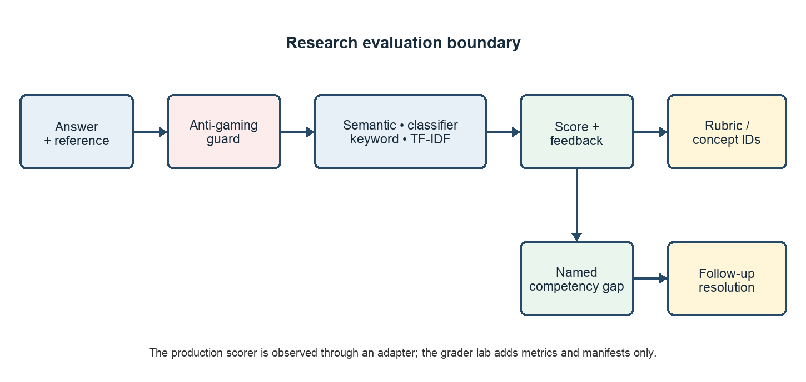

# interViv: Auditable Diagnostic Scoring for Technical Interview Practice

*Anonymous submission*

## Abstract

Automated interview-practice systems can produce confident scores without showing whether those scores generalize or which evidence supports their feedback. We evaluate interViv's current deterministic short-answer scorer as a diagnostic component rather than as a learner-readiness predictor. A reproducible grader lab compares lexical similarity, a pinned semantic similarity plus contradiction heuristic, and the current guarded pipeline on the five-way SciEntsBank (n=5,835) and BEETLE (n=1,258) Core test sets. interViv reaches macro-F1 0.246 and 0.161, below the semantic baseline's 0.335 and 0.277. It has the lowest off-topic false-positive rates (0.009 and 0.007) but also low off-topic recall (0.062 and 0.010), and it exposes no contradiction signal (0/894 detected). Feedback statements have complete structural evidence identifiers, but this does not establish citation correctness. A four-case follow-up result is reported only as a synthetic pilot. Ablations indicate domain-sensitive weighting: removing the classifier aggregation term improves macro-F1 on both benchmarks. These results reject broad superiority claims and identify calibration, contradiction handling, and human validation as prerequisites for stronger educational claims.

**Index Terms—** automated short-answer grading; diagnostic feedback; auditability; technical interview practice; evidence tracing; benchmark evaluation

## I. INTRODUCTION

Practice systems for technical interviews combine two tasks that should be evaluated separately: generating a useful question and judging the learner's response. A fluent prompt generator can increase variety, but a scoring component influences what the learner studies next. That component therefore needs external benchmark evidence, explicit failure modes, and a trace from each feedback statement to the scoring evidence that licensed it.

interViv is an interview-practice prototype whose current scorer combines semantic, classifier, keyword, TF-IDF, knowledge-graph, entity, and anti-gaming signals. Earlier descriptions emphasized the complete application and small internal validation exercises. This paper narrows the contribution to the diagnostic scorer. We exclude learner-readiness improvement, hiring validity, and the non-blinded pilot from the empirical claim set.

We ask three questions. RQ1: how does the current scorer generalize relative to lexical and semantic baselines on external five-way short-answer grading? RQ2: what safety-auditability trade-off is visible in off-topic errors, contradiction detection, and evidence citations? RQ3: can exact competency-gap resolution be measured in a deliberately limited synthetic follow-up pilot?

The contributions are: (1) a shared-schema, manifest-stamped grader lab; (2) an external comparison and research-only component ablation of the current pipeline; (3) explicit evidence-citation and exact-gap-resolution metrics; and (4) a negative result showing where the present scorer is not yet competitive.

## II. RELATED WORK

### A. Automated short-answer grading

SciEntsBank and BEETLE were consolidated in SemEval-2013 Task 7 as five-way student-response classification data [1]. Representation-based grading progressed from lexical matching toward contextual encoders [2], including Sentence-BERT [3]. ASAG2024 highlights the continued difficulty of cross-question and cross-domain generalization [4]. Recent response-level studies show that aggregate metrics conceal difficulty-dependent collapse [5] and mid-range degradation [6]. We therefore report accuracy and macro-F1 together with targeted safety and evidence metrics rather than treating one score as a complete evaluation.

### B. LLM grading and auditability

LLM judges can scale rubric application, but reliability, bias, prompt dependence, and interpretability remain open problems [7], [8]. A 2026 rubric-guided study found gains for a larger model but degradation for a smaller model; it also observed rationales containing hallucinated rubric elements [7]. Cross-disciplinary ChatGPT grading similarly showed consistency alongside leniency and compressed grade distributions [9]. These findings motivate explicit evidence identifiers, but identifiers alone cannot prove that a feedback claim is warranted.

### C. Adaptive interview systems

AI interviewer research has begun to evaluate adaptive questioning at scale. Panfilova et al. compare six models using 2,900 human annotations [10], while recent technical mock-interview work studies readiness and confidence [11]. Those studies focus on interviewing behavior or learner experience. Our narrower unit is the diagnostic judgment attached to one answer and, synthetically, the resolution of one identified competency gap.

## III. DIAGNOSTIC SCORING AND EVIDENCE

### A. Scoring boundary

The research adapter calls the existing production scorer without changing application logic. For an answer a and reference r, the pipeline computes a bounded semantic component, a saved logistic-regression component, keyword coverage, and TF-IDF similarity. Knowledge-graph and entity bonuses are added, penalties are subtracted, and any anti-gaming cap is applied last. The saved classifier also consumes a semantic-derived feature; consequently, the component ablations are sensitivity tests rather than causal isolation.

S = min(Cg, 100(0.45ssem + 0.25sclf + 0.20skw + 0.10stfidf) + bKG + bNER − p).

### B. Feedback evidence contract

Every emitted feedback statement can list evidence IDs from an available set. Rubric evidence uses rubric.* and concept evidence uses concept.*. Evidence-citation completeness is the fraction of feedback statements citing at least one valid rubric or concept ID. Unsupported-feedback rate is computed separately from whether the citation is explicit. Both are structural checks; human adjudication is required to establish substantive support or pedagogical usefulness.

### C. Follow-up resolution

A follow-up record names the exact trigger gap and whether the second answer resolves it. Resolved-evidence rate is the accuracy of that exact-gap judgment. SciEntsBank and BEETLE are single-turn data, so this metric is never reported as benchmark validation; all corresponding rows carry pilot_synthetic=true.

## IV. EVALUATION

### A. Data and labels

We normalize the official SemEval five-way Core test partitions to a shared JSONL schema: correct, partially correct/incomplete, contradictory, irrelevant, and non-domain. SciEntsBank contributes 5,835 examples and BEETLE 1,258. Their organizer package is CC BY-SA 3.0. An internal 17-example set covers off-topic, vague, keyword-stuffed, contradictory, partial, clean-control, and four follow-up cases. RiceChem is absent and recorded as pending_access rather than silently omitted.

### B. Baselines

Lexical similarity uses content-token F1. The semantic baseline uses the pinned all-MiniLM-L6-v2 checkpoint plus an inspectable negation/antonym heuristic; it is not a trained NLI model. The interViv baseline uses the current scorer and guards. A structured LLM rubric-judge interface exists only as a disabled configuration stub. It is marked deferred, made zero API/network calls, and leaves this comparison incomplete.

### C. Metrics and protocol

We report five-way accuracy and macro-F1; off-topic recall and false-positive rate; contradiction recall; unsupported-feedback rate; and evidence-citation completeness. The synthetic follow-up pilot additionally reports exact-gap resolution. All models run offline. The clean run records 7,110 applicable interViv predictions, 7,110 semantic function calls, and zero lexical fallbacks. No test-set tuning was performed after inspecting the results.

### D. Reproducibility manifest

The primary run is grader-lab-20260815T160016Z; ablation is grader-lab-20260815T161227Z; and contradiction analysis is grader-lab-20260815T161440Z. All record commit 8758ecfed517 (dirty research worktree), dataset versions and SHA-256 digests, Python/runtime versions, embedding revision 1110a243fdf4, and classifier artifact 2897c8cc6283. The frozen CSV/Markdown hashes are listed in the supplemental experiment-freeze file.

## V. RESULTS

### A. Five-way grading

On SciEntsBank, interViv improves accuracy over the lexical baseline (0.373 vs. 0.358) but is below the semantic baseline (0.399). Its macro-F1 (0.246) is effectively the lexical result (0.245) and below semantic (0.335). On BEETLE, interViv is worse in both accuracy (0.170) and macro-F1 (0.161) than lexical (0.338, 0.274) and semantic (0.304, 0.277). RQ1 therefore has a negative answer: the current aggregate does not generalize competitively across the two benchmark domains.

**Table I. Accuracy and macro-F1 (benchmark-validated).**

| Dataset / metric | Lexical | Semantic | interViv |
| --- | ---: | ---: | ---: |
| SciEntsBank Accuracy | 0.358 | 0.399 | 0.373 |
| SciEntsBank Macro-F1 | 0.245 | 0.335 | 0.246 |
| BEETLE Accuracy | 0.338 | 0.304 | 0.170 |
| BEETLE Macro-F1 | 0.274 | 0.277 | 0.161 |

### B. Safety and contradictions

interViv produces the lowest off-topic false-positive rate on both datasets, but this apparent safety is coupled to very low detection recall. SciEntsBank recall/FPR is 0.062/0.009 versus lexical 0.407/0.141; BEETLE is 0.010/0.007 versus lexical 0.727/0.085. The semantic baseline offers a less extreme trade-off. interViv detects 0/539 SciEntsBank and 0/355 BEETLE contradictions because the current adapter exposes no contradiction output. The semantic heuristic detects 170/539 and 148/355. Of its 576 misses, automatic rules resolve only one as a factual reversal; 575 require human review.

### C. Auditability and follow-up pilot

interViv feedback has 100% evidence-citation completeness and zero automatically unsupported claims in this run. However, the semantic research baseline also reaches 100% because its adapter emits evidence IDs, and the deferred LLM judge prevents an opaque-judge comparison. The result supports only a structural traceability claim. On four internal follow-up cases, interViv and the semantic baseline each judge exact-gap resolution correctly in 4/4 cases; lexical obtains 3/4. This is synthetic-only pilot evidence, not a learner-outcome result.

### D. Component sensitivity

Removing the classifier final-score term improves macro-F1 from 0.246 to 0.251 on SciEntsBank and from 0.161 to 0.205 on BEETLE. Removing semantic evidence lowers SciEntsBank macro-F1 to 0.231 but raises BEETLE to 0.179. Removing guards raises SciEntsBank macro-F1 to 0.258 yet lowers BEETLE to 0.128 and eliminates the explicit off-topic flag. The differences indicate domain-sensitive calibration and a measurable guard trade-off, not one universally dominant component.

**Table III. Research-only macro-F1 ablations.**

| Configuration | SciEntsBank | BEETLE | Synthetic pilot* |
| --- | ---: | ---: | ---: |
| Full | 0.246 | 0.161 | 0.578 |
| − semantic | 0.231 | 0.179 | 0.267 |
| − classifier term | 0.251 | 0.205 | 0.567 |
| − keyword term | 0.246 | 0.159 | 0.523 |
| − TF-IDF term | 0.250 | 0.159 | 0.578 |
| − guards | 0.258 | 0.128 | 0.455 |

* pilot_synthetic=true; not benchmark evidence.

## VI. DISCUSSION AND LIMITATIONS

The strongest current result is diagnostic rather than promotional. Semantic execution is verified, so the poor BEETLE result cannot be explained by a silent lexical fallback. The combination of low false positives and very low recall indicates that the guard is conservative. The classifier-term ablation and opposite semantic effect across domains identify calibration as a priority for future work. Contradiction detection is a missing capability at the scorer-output boundary, not merely a threshold problem.

The evaluation has several limits. First, benchmark labels do not cleanly isolate low effort, so the off-topic result cannot be generalized to every low-effort answer. Second, the contradiction taxonomy is almost entirely unresolved without human review. Third, citation completeness checks the presence of valid IDs, not the truth, sufficiency, or pedagogical quality of a statement. Fourth, the four follow-ups are constructed examples. Fifth, the structured LLM judge is deferred and RiceChem is pending, so the comparison is explicitly incomplete.

No result here establishes improved readiness, retention, fairness across learner groups, or hiring validity. Those claims require a consented longitudinal study with blinded human adjudication. The earlier non-blinded pilot is excluded from the main evidence. Future research should add an independently adjudicated contradiction set, calibrate on development data without touching the test partitions, implement the structured-judge comparison under an approved cost/privacy policy, and collect real follow-up conversations.

## VII. CONCLUSION

A reproducible evaluation of interViv's current diagnostic scorer finds complete structural evidence tracing and low off-topic false positives, but weak off-topic recall, no contradiction output, and substantial cross-domain calibration failure. The semantic baseline outperforms the current aggregate on macro-F1 in both external benchmarks. Treating these as first-class negative results converts an application description into a falsifiable research artifact. Stronger claims about LLM comparison, follow-up resolution, or learner readiness remain deferred until the missing baselines and human studies exist.

## REFERENCES

[1] M. Dzikovska et al., “SemEval-2013 Task 7: The Joint Student Response Analysis and 8th Recognizing Textual Entailment Challenge,” in Proc. SemEval, 2013, pp. 263–274.

[2] S. Haller, A. Aldea, C. Seifert, and N. Strisciuglio, “Survey on automated short answer grading with deep learning: From word embeddings to transformers,” arXiv:2204.03503, 2022.

[3] N. Reimers and I. Gurevych, “Sentence-BERT: Sentence embeddings using Siamese BERT-networks,” in Proc. EMNLP-IJCNLP, 2019, pp. 3982–3992.

[4] G. Meyer, P. Breuer, and J. Fürst, “ASAG2024: A combined benchmark for short answer grading,” in Proc. SIGCSE Virtual, 2024, doi:10.1145/3649409.3691083.

[5] L. Cong, S. Hahn, S. Gombert, L. Camus, H. Drachsler, and U. Kroehne, “Estimating LLM grading ability and response difficulty in automatic short answer grading via item response theory,” in Proc. BEA, 2026, pp. 259–271, doi:10.18653/v1/2026.bea-1.19.

[6] A. Gurin Schleifer, M. Ariely, B. Beigman Klebanov, A. Salman, and G. Alexandron, “Quality-conditioned agreement in automated short answer scoring,” in Proc. BEA, 2026, pp. 432–442, doi:10.18653/v1/2026.bea-1.29.

[7] S. Haque, D. Hettiachchi, and D. Beck, “Rubric-guided prompting for automatic assessment scoring,” in Proc. L@S, 2026, pp. 428–432, doi:10.1145/3774398.3811581.

[8] J. Gu et al., “A survey on LLM-as-a-judge,” The Innovation, vol. 7, no. 6, Art. 101253, 2026, doi:10.1016/j.xinn.2025.101253.

[9] R. Awashreh, H. Al Ghunaimi, and S. AlGhenaimi, “Reliable but not rigorous: Evaluating ChatGPT's reliability, validity, and bias in automated academic grading,” Social Sciences & Humanities Open, Art. 102788, 2026, doi:10.1016/j.ssaho.2026.102788.

[10] A. Panfilova et al., “The AI interviewer: Multi-faceted evaluation of adaptive questioning by large language models,” Scientific Reports, vol. 16, Art. 20257, 2026, doi:10.1038/s41598-026-46517-7.

[11] N. Gomez, S. S. Batham, M. Volonte, and T. D. Do, “Virtual interviewers, real results: Exploring AI-driven mock technical interviews on student readiness and confidence,” arXiv:2506.16542, 2025.
