# interViv: A Guarded Deterministic Scoring Framework for LLM-Generated Adaptive Mock Interviews

IEEE Access-style extended manuscript draft. Replace author metadata before submission.

## Abstract

Interview preparation for students increasingly involves generative AI tools, yet many systems blur the boundary between generating practice material and judging candidate quality. This paper presents interViv, an interview readiness platform that deliberately separates these concerns. The platform uses large language models only for company-aware, role-aware, skill-aware, difficulty-aware, and resume-aware question generation. Candidate answer scoring, feedback, anti-gibberish checks, readiness computation, adaptive difficulty, and dashboard decisions are implemented through deterministic Python modules.

The current implementation includes a FastAPI backend, React frontend, fallback question bank with 53 structured questions, curated company-role graph with 8 companies, 16 roles, and 80 skill requirements, a three-layer scoring pipeline, answer-quality classifier, knowledge-graph concept scorer, entity extractor, and guard-cap mechanism. Preliminary evaluation includes 116 passing automated tests, a balanced classifier dataset of 891 labelled answers, an interview dataset of 2319 answer examples, a primary human baseline of 30 rated answers, and a persona-simulation validation set of 200 examples. The primary human baseline reports average Cohen's kappa of 0.642 and system-human Pearson correlation of 0.7392.

The contribution of this paper is not a claim that interViv predicts hiring success. Instead, it describes a reproducible architecture for guarded, explainable interview practice where generative AI increases variety while deterministic scoring preserves auditability. The manuscript also documents a publication-ready evaluation plan for a larger student-readiness study.

## Index Terms

Automated short-answer grading, interview readiness, educational technology, adaptive learning, learning analytics, large language models, deterministic scoring, answer guardrails, technical interviews, student preparation.

## 1. Introduction

Technical interviews are a high-stakes transition point for students and early-career candidates. Students often prepare by collecting question lists, watching solution walkthroughs, and practicing alone. These workflows are fragmented: they do not reliably connect practice to a target role, they rarely adapt to weak concepts, and they frequently offer feedback that is too vague to guide repeated preparation. Generative AI tools can produce plausible interview questions, but using the same model as a judge creates reproducibility, calibration, and fairness concerns.

interViv is designed around a narrower and more defensible premise. The platform uses an LLM as a constrained question generator, not as an evaluator. The LLM produces a question, ideal answer, expected keywords, topic metadata, and follow-up prompts. Candidate answers are then evaluated by deterministic Python modules: the answer guard checks for empty, gibberish, repeated, off-topic, and keyword-stuffed answers; the scoring pipeline computes lexical, semantic, structural, knowledge-graph, and classifier signals; and the dashboard converts stored evidence into weak-skill and roadmap recommendations.

This separation gives the project a research identity that is stronger than a generic AI interview assistant. It enables controlled question variety while preserving stable scoring behavior. It also supports a practical research question: can an interview-readiness system combine LLM-generated practice material with deterministic assessment signals in a way that is useful, auditable, and resistant to meaningless answers?

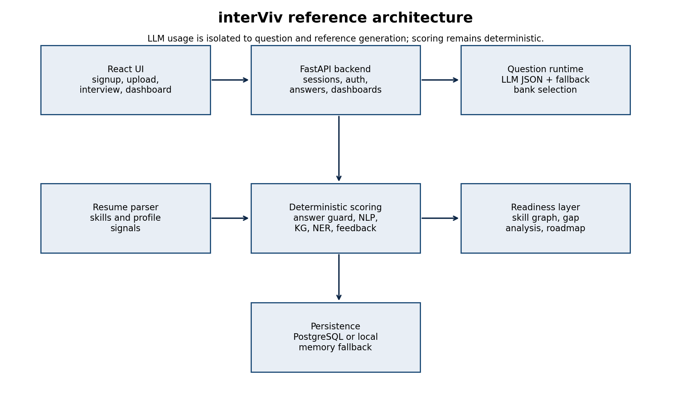

## 2. Research Motivation and Problem Statement

The target user is a student or early-career candidate preparing for placement, internship, or entry-level software roles. Such users need role-aligned practice, repeated feedback, and clear next actions. They also need guardrails against accidental overconfidence: an answer that repeats keywords, copies the question, or contains random text should not receive a normal score simply because it overlaps with expected vocabulary.

The research problem can be stated as follows: how can a technical-interview practice platform use the generative strength of LLMs without delegating candidate judgment to a non-deterministic evaluator? The design answer in interViv is a strict boundary. The LLM may produce questions and reference material; it may not grade answers, produce feedback, decide readiness, or act as an interviewer-judge.

The project therefore studies a hybrid architecture in which generative AI is a content source and deterministic analytics form the assessment layer. This framing fits the educational assessment literature, where open-ended answers are valued but difficult to grade at scale, and where hybrid scoring features remain important for interpretability and reliability.

## 3. Contributions

The first contribution is a constrained LLM question-generation interface. The generator must return JSON containing the question, ideal answer, ideal keywords, sub-domain, topic, difficulty, question type, company, role, and follow-ups. The prompt explicitly forbids scoring, judging, grading, evaluation, pass/fail decisions, and feedback generation.

The second contribution is a deterministic scoring pipeline for open-ended interview answers. The pipeline combines answer guardrails, lexical and semantic similarity, keyword coverage, concept coverage, structural quality, classifier signal, knowledge-graph matching, NER evidence, and rule-based feedback. The answer guard runs before scoring and its caps are hard limits.

The third contribution is a student-readiness layer. interViv stores skill and concept evidence, computes role gap analysis, adapts question difficulty, and generates preparation roadmaps. These outputs are dashboard explanations, not hiring decisions.

The fourth contribution is a reproducibility and evidence package: automated tests, question-bank audit, model metadata, baseline reports, documentation, and deployment configuration.

## 4. Related Work

Recent work on AI-driven mock technical interviews shows that simulated interviews can support student confidence and readiness when designed as formative practice environments. interViv shares this educational goal but differs by refusing to use the LLM as an answer judge.

LLM-based question generation has become a practical technique for creating varied educational material. Prior work on automatic multiple-choice question generation uses prompt engineering and review processes to improve generated question quality. interViv applies a similar generation-plus-validation pattern, but for technical and behavioral interview prompts rather than only MCQs.

Automated short-answer grading research supports hybrid approaches. Surveys describe the value of combining engineered lexical and structural features with modern semantic representations. ASAG benchmark work also notes that LLM-based grading has improved but remains short of human performance in general settings. These findings support interViv's design choice: use deterministic signals for scoring and reserve LLMs for question generation.

Adaptive interviewing and adaptive learning research motivates the use of follow-ups, difficulty adjustment, and learner modeling. interViv implements these ideas conservatively through Elo-style difficulty updates, skill graphs, and concept mastery rather than through opaque LLM reasoning.

| Research area | What it supports | How interViv uses it |
| --- | --- | --- |
| AI mock interviews | Practice realism and confidence-building | Student readiness practice |
| LLM question generation | Controlled generation of educational prompts | Question JSON and fallback bank |
| ASAG | Hybrid feature-based answer scoring | Deterministic rubric signals |
| Adaptive learning | Skill targeting and difficulty adjustment | Elo, weak concepts, roadmap |

## 5. System Overview

interViv is implemented as a web platform with a React frontend and FastAPI backend. The frontend contains the landing page, signup/login flows, resume upload, interview workspace, and dashboard. The backend exposes auth, resume, company, session, answer, dashboard, learning, gap-analysis, roadmap, transcription, and admin routes.

The core execution path begins when a user creates or resumes a session. The system selects a skill, company, role, weak concept, and difficulty. It requests a question from the LLM when configured, validates the JSON shape, and falls back to the structured question bank if the provider fails or fallback mode is selected. When the candidate submits an answer, the backend ignores client-side scoring fields and recomputes all scoring evidence server-side.

Persistence is available through PostgreSQL with SQLAlchemy and Alembic, with an in-memory fallback for local demos and continuous integration. This makes the platform usable in research, demonstration, and deployment contexts.

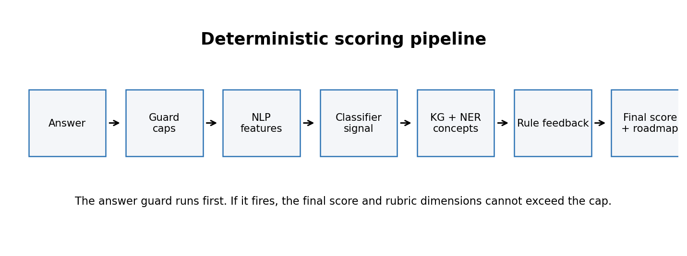

## 6. LLM Boundary and Question Generation Contract

The LLM boundary is the central design constraint. The generator may produce only question and reference metadata. The required JSON fields are question, ideal_answer, ideal_keywords, sub_domain, topic, difficulty, question_type, company, role, and followups. The backend stores ideal_answer and ideal_keywords as deterministic scoring references.

Question selection follows a priority order: selected company, selected role, resume extracted skills, weak skills, adaptive difficulty, and fallback bank. This ensures that the model receives a meaningful context without being allowed to decide the candidate's score.

This architecture also improves failure behavior. If the LLM call fails, the system can fall back to a structured bank with the same schema. The evaluator receives a consistent question_context object regardless of whether the question came from an LLM or from the bank.

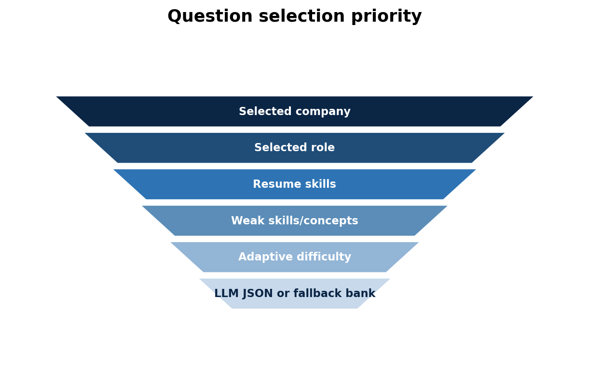

## 7. Structured Fallback Question Bank

The fallback question bank contains 53 rows with schema: company, role, skill, sub_domain, topic, difficulty, question_type, question, ideal_answer, ideal_keywords, and followups. Every row contains the reference fields needed by deterministic scoring.

The current bank covers DSA, DBMS, OS, CN, OOP, Python, JavaScript, React, Node.js, FastAPI, System Design, and HR/Behavioral. It also covers TCS, Infosys, Accenture, Wipro, Amazon, Microsoft, Google, and Meta. The bank is intentionally schema-compatible with LLM-generated questions, which makes fallback behavior transparent to the scoring pipeline.

The latest audit reports schema OK, zero errors, and 22 warnings. The warnings identify role labels in fallback questions that are broader than some company graph entries. This is useful cleanup work, but it does not block safe fallback generation.

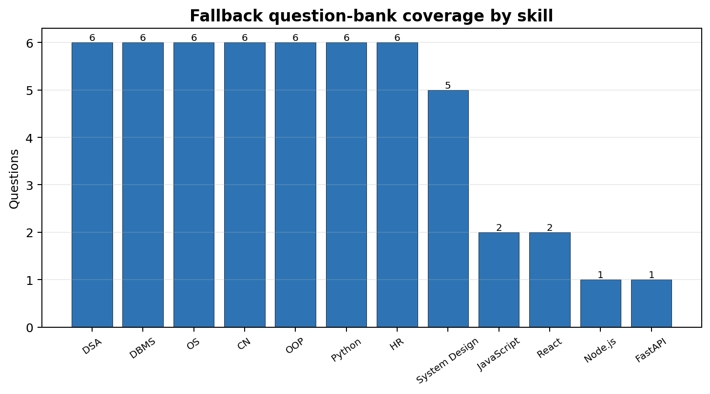

## 8. Company, Role, and Resume Awareness

The company hiring graph contains 8 companies, 16 roles, and 80 role-skill requirements. Each role stores required skills, required levels, and importance weights. These profiles are curated reference profiles for practice preparation, not exact recruiter rubrics.

When a user selects a company and role, the gap-analysis layer compares the user's skill graph against the target role profile. Resume extraction contributes candidate skills, while session performance contributes observed mastery and weak concept signals. This combination makes question selection more realistic for students than a generic interview question list.

The company layer is deliberately framed as practice support. The platform does not claim to represent proprietary hiring criteria and does not predict whether a candidate will pass a real interview.

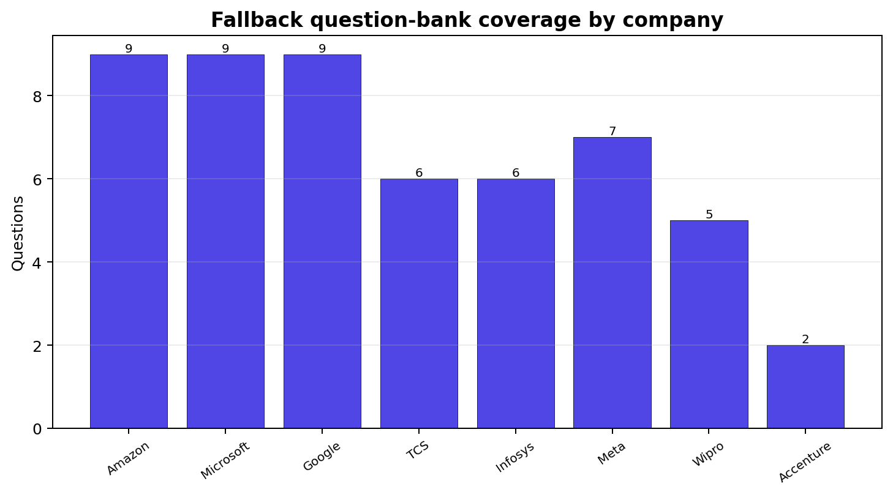

## 9. Deterministic Scoring Pipeline

The scoring entry point is backend/scoring/pipeline.py. The answer route invokes the pipeline when the candidate submits a round. The pipeline first runs answer_guard, then computes NLP signals, classifier label, knowledge graph score, NER entities, rule-based feedback, and final score.

The final-score formula uses semantic or lexical match, classifier component, keyword coverage, TF-IDF overlap, KG bonus, NER bonus, and penalties. The formula is deterministic for a fixed model artifact and reference context. Model metadata stores the classifier type, feature order, dataset hash, validation metrics, and artifact checksum.

The current scoring schema also exposes rubric-style dimensions: correctness, coverage, depth, and clarity. These dimensions are derived from existing deterministic signals and do not replace the calibrated final-score formula.

## 10. Answer Guardrails and Anti-Gaming Design

The answer guard protects the system from meaningless input. It detects empty answers, whitespace-only answers, random character strings, abnormal vowel ratios, repeated character ratios, repeated token ratios, keyboard spam, keyword stuffing, question parroting, low-density filler, and off-topic responses.

If the guard fires, the score cap is applied after normal scoring but remains a hard upper bound. Empty answers are capped at 5, gibberish at 10, repeated meaningless text at 15, too-short answers at 20, and keyword stuffing at 35. The dashboard receives structured guard information: applied, reason, score_cap, guards_fired, and softened status.

This mechanism addresses a major failure mode in naive automated scoring: random text can receive nonzero overlap by chance, and keyword lists can mimic topic relevance without explanation. interViv caps such cases before they can become normal readiness evidence.

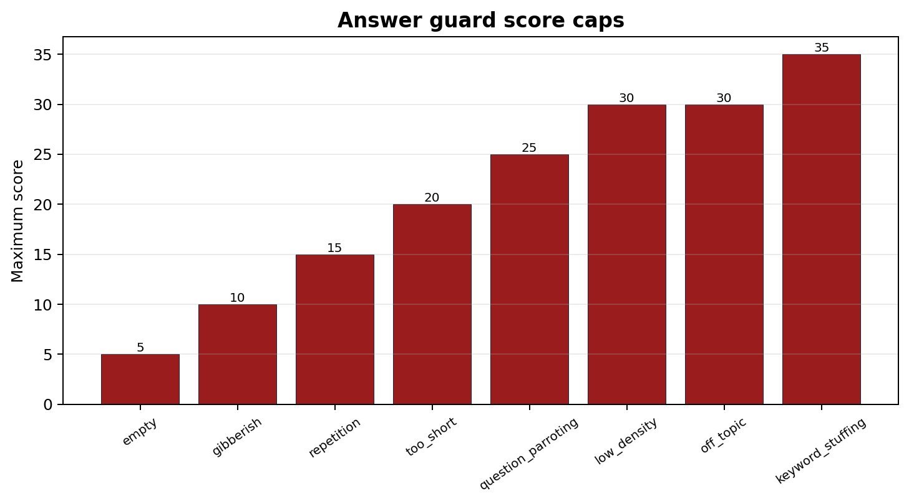

## 11. Rubric-Oriented Explainability

The rubric view is designed for user-facing explanation rather than hidden model training. Correctness is computed from semantic or lexical evidence and classifier signal. Coverage combines keyword coverage, concept coverage, and KG score. Depth combines technical depth and KG score. Clarity combines structure, clarity, and length fit.

When a guard cap is active, rubric dimensions are capped as well. This prevents a confusing report where the final score is low but dimension scores appear strong. The result is a coherent explanation: an invalid or incomplete answer cannot receive normal-looking rubric evidence.

The dashboard presents both low-level signals and named dimensions. This dual view is useful for research because the pipeline remains auditable, while students see a simpler explanation of what to improve.

| Dimension | Primary deterministic signals | Student-facing meaning |
| --- | --- | --- |
| Correctness | semantic_or_lexical, classifier | Does the answer match the core idea? |
| Coverage | keyword, concept, KG | Are expected terms and concepts covered? |
| Depth | depth score, KG | Does the answer reason beyond a definition? |
| Clarity | structure, clarity, length fit | Is the explanation readable and organized? |

## 12. Adaptive Difficulty and Skill Targeting

interViv adapts practice through deterministic state. Each skill has an Elo-style rating that changes after scored rounds. Difficulty selection is based on the updated rating, while weak-skill and weak-concept targeting uses stored skill graph and concept mastery data.

The adaptive selector is conservative. Anonymous sessions follow rotation behavior, while authenticated users with enough state can be routed toward weak concepts and role gaps. This prevents the system from overfitting early sessions while still enabling personalization as evidence accumulates.

The design favors interpretability over aggressive optimization. The dashboard can explain why a topic was recommended: it was missed in concept coverage, weak in the skill graph, required by the target role, or selected due to adaptive difficulty.

## 13. Dashboard and Learning Analytics

The dashboard is the student-facing learning analytics layer. It shows overall readiness score, company practice, role practice, skill library, weak skills, recent sessions, replay or past questions, and recommended roadmap. Session reports show content match, semantic similarity, keyword coverage, structure score, guard warnings, missing concepts, ideal answer, and next recommended topics.

The dashboard does not invent decisions. It displays fields produced by the backend: final score, scoring breakdown, guard, concepts, topic metadata, ideal answer, and follow-ups. This design maintains traceability from the UI back to deterministic scoring evidence.

For research use, the dashboard can serve both as an intervention and an observation tool. It guides students toward next topics and stores the evidence needed to analyze score trends, weak skill reduction, and guard-trigger frequency over time.

## 14. Implementation Details

The backend is organized around FastAPI routers. Auth implements signup, login, and me endpoints using JWT. Session routes create and progress interview sessions. Answer routes run scoring and persist completed rounds. Dashboard routes sanitize session data and compute aggregate readiness views.

The modules directory contains dynamically loaded scoring and generation components: nlp_scorer, nlp_scorer_patch, answer_guard, question_runtime, question_bank, semantic_scorer, knowledge_graph, ner_scorer, c4_feedback, skill_graph, concept_mastery, and roadmap_generator.

The frontend is a Vite React application with React Router. It contains pages for landing, login, signup, resume upload, interview, dashboard, gap analysis, and roadmap. Dashboard components are TypeScript-based and consume the structured scoring breakdown.

| Layer | Key files | Purpose |
| --- | --- | --- |
| Frontend | frontend/src/pages, components/dashboard | Practice UI and readiness reports |
| Backend routes | backend/routes | Auth, sessions, answers, dashboards |
| Scoring | backend/scoring/pipeline.py, modules | Deterministic answer evaluation |
| Data | data/*.csv, company_hiring_graphs.yaml | Questions, labels, role profiles |
| Tests | tests/ | Regression and behavior verification |

## 15. Datasets and Artifacts

The large interview dataset contains 2319 rows and is balanced across Good, Average, and Poor labels, with 773 rows per label. It covers DBMS, System Design, ML, CN, DSA, Python, OOP, OS, HR, Java, and JavaScript.

The answer-quality classifier training data contains 891 rows, balanced across 297 Good, 297 Average, and 297 Poor examples. Metadata records the dataset hash and feature order, making model provenance auditable.

The fallback question bank contains 53 structured questions. Unlike the training dataset, it is designed for live fallback and contains ideal answers, ideal keywords, follow-ups, role labels, companies, and question types.

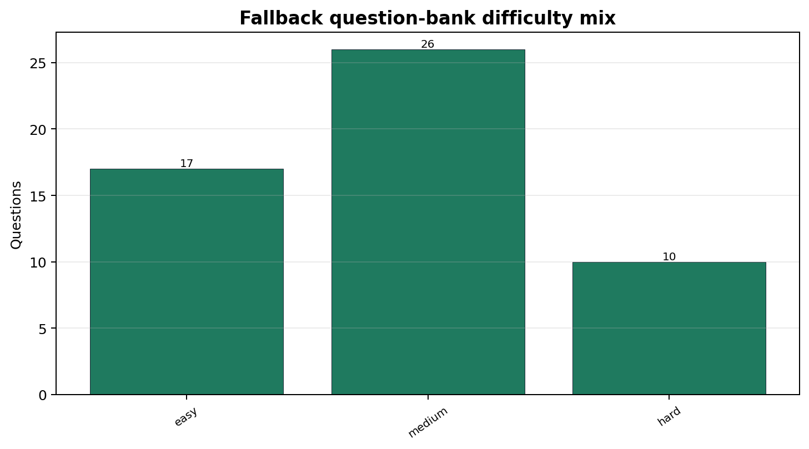

## 16. Classifier Validation

The current answer-quality classifier is LogisticRegression trained on 891 balanced rows. Metadata reports validation accuracy 0.9553, macro F1 0.9551, weighted F1 0.9552, five-fold cross-validation accuracy mean 0.9562, and standard deviation 0.0148.

These metrics are classifier-only validation metrics on labelled answer-quality data. They are not whole-system accuracy, interview-readiness accuracy, or hiring prediction accuracy. The paper should preserve this distinction during submission.

The classifier is used as one component of the final score. It does not override the guard and does not independently decide readiness.

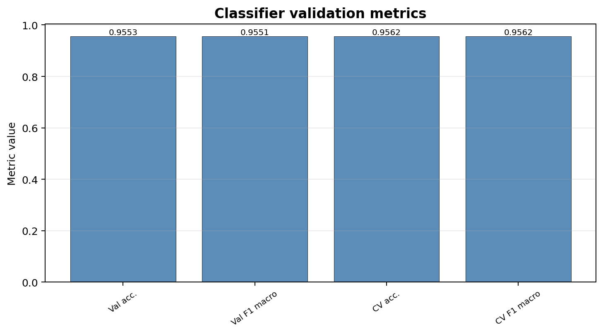

## 17. Human Baseline Evaluation

The primary human baseline contains 30 answers rated by three annotators. Average Cohen's kappa is 0.642, which is interpreted as substantial agreement under the scale documented in the baseline report. The system-human Pearson correlation is 0.7392 with p-value reported as 0.0000 in the project report.

The baseline also exposes important error cases. Top disagreements include cases where the answer content appears mismatched to the question or where concise high-quality answers are under-scored. These disagreements are useful for future calibration and should be discussed honestly rather than hidden.

The baseline is small, but it provides a credible starting point for a system paper. A publication submission should expand this evaluation with additional human-rated answers and a student-participant study.

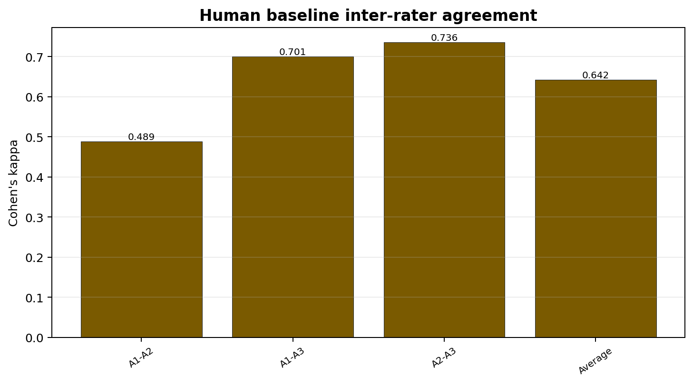

## 18. System-Human Agreement Results

The system-human correlation chart shows that correlation varies by annotator: 0.556, 0.824, and 0.719 for the three annotators, with a mean system-human correlation of 0.7392. This level of agreement is promising for a preliminary deterministic scoring system but not sufficient to claim replacement-level grading.

The confusion matrix shows that the system identifies many Good examples but also assigns some Good human-mean answers to Average or Poor bands. The paper should interpret this conservatively: interViv is a formative readiness tool whose feedback can guide practice, not a summative credentialing engine.

This framing aligns with the project's product identity. Scores should help students improve, not certify employability.

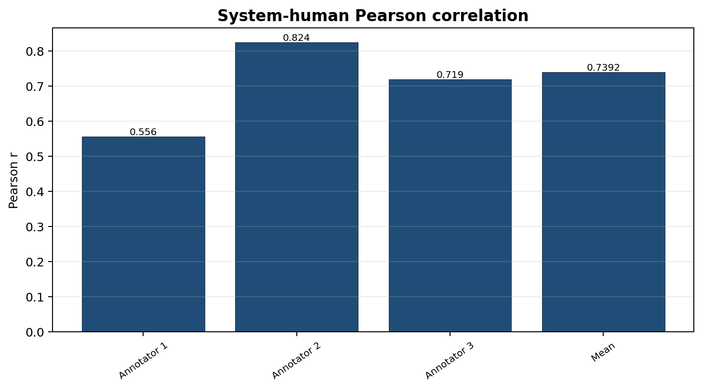

## 19. Confusion Matrix Analysis

The primary human baseline confusion matrix is organized as human mean band by system predicted band. The strongest diagonal count occurs in the Good-Good cell. Average and Poor bands show more ambiguity, which is common in short-answer grading because partial answers can contain some correct concepts while lacking depth or structure.

The matrix suggests two improvement paths. First, the system should better recognize concise but technically complete answers. Second, future calibration should separate off-topic high-quality explanations from on-topic concise answers. The answer guard and rubric view help with this distinction, but additional labelled examples are needed.

The paper uses these findings as design feedback. It does not claim a final validated grading instrument.

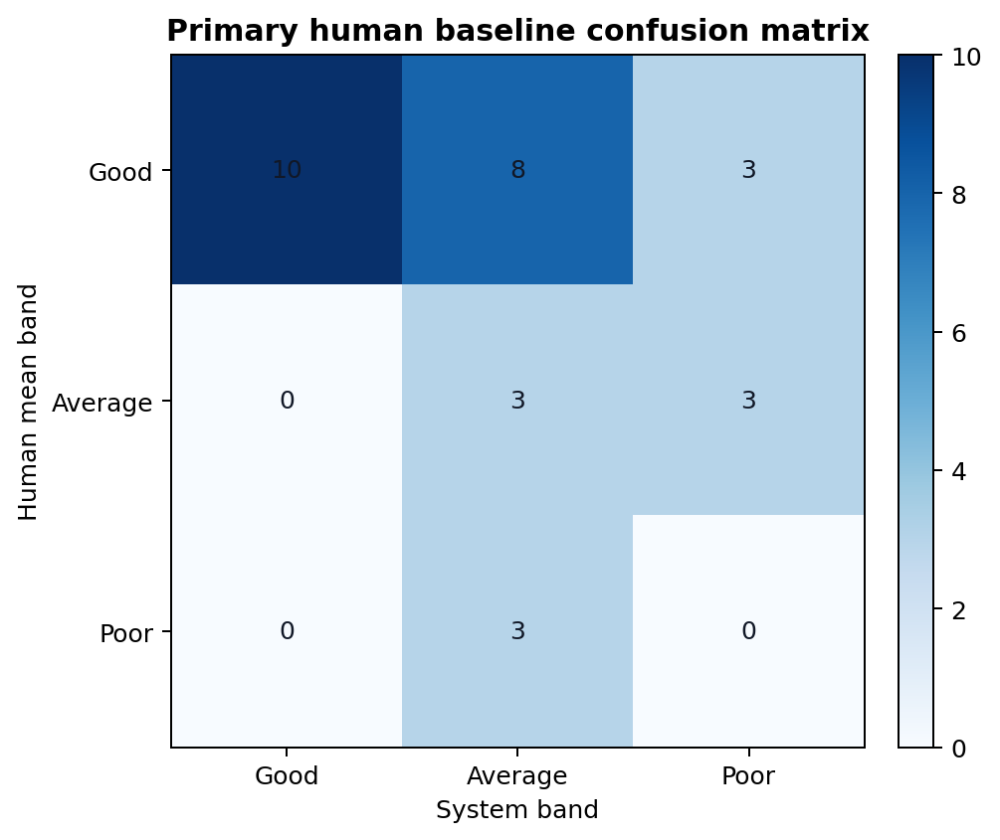

## 20. Persona-Simulation Validation

The project also includes a persona-simulation validation file with 200 rows and four annotators. It reports average kappa 0.640 and Pearson correlation 0.9578. This result is useful for stress testing and calibration but should not be treated as equivalent to a real human-participant study.

In the manuscript, persona validation is therefore placed as secondary evidence. It demonstrates that the deterministic scoring pipeline can behave consistently under controlled answer patterns, while the primary human baseline remains the more important external-validity evidence.

A rigorous publication path should include real student participants and independent human raters before claiming educational impact.

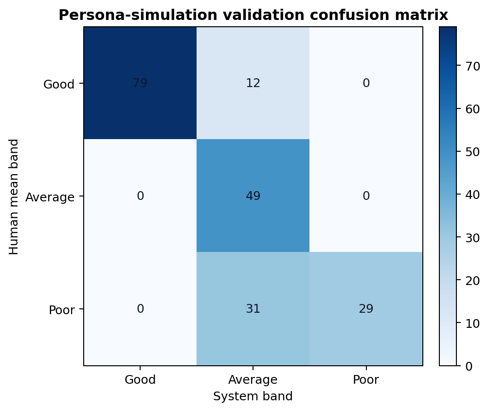

## 21. Guard Stress Testing

Guard stress testing checks whether invalid answers can still obtain normal scores. Direct verification examples show that 'gctcititxi' receives final score 5.0 with gibberish guard, 'fvitugceigc vgcyutrxrtxtci' receives 5.0 with gibberish guard, and a normal binary-search explanation receives 80.38 without a guard.

Automated tests cover empty answers, whitespace-only answers, random tokens, keyboard spam, repeated meaningless tokens, repeated keyword-only text, keyword stuffing, and meaningful short technical answers. Meaningful examples such as binary search, database indexing, and process scheduling are not flagged by the guard.

The guard therefore protects the central scoring claim: meaningless text must not receive normal readiness evidence.

| Input type | Expected behavior | Observed evidence |
| --- | --- | --- |
| Random single token | Score <= 10 | 5.0, gibberish |
| Random two tokens | Score <= 10 | 5.0, gibberish |
| Normal binary search | No gibberish guard | 80.38, no guard |
| Keyword stuffing | Score <= 35 | Regression tested |

## 22. Automated Verification

The full test suite currently reports 116 passed tests and 6 warnings. The warnings are not failed behavior: they include deprecation warnings, short JWT-secret warnings in local test configuration, and tests that return dictionaries in semantic test helpers.

The test suite covers adaptive selection, answer guard, authentication, server-side metrics, scoring breakdown, baseline analysis, company graph, dashboard confidence bands, gap analysis, guard v2 behavior, model credibility, scoring calibration, roadmap, semantic scoring, skill graph, and question-generation hardening.

This breadth matters for research reproducibility. The paper can point to a runnable artifact whose core behavior is covered by tests instead of only describing an architecture diagram.

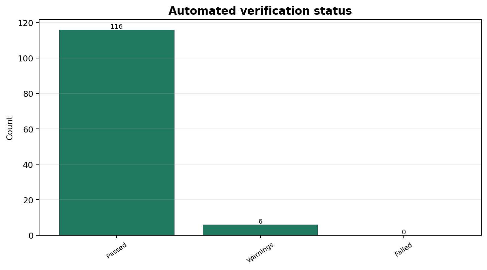

## 23. Security, Privacy, and Deployment Considerations

interViv handles resumes, answers, and authentication tokens, so deployment must use secure configuration. The production path supports PostgreSQL, Redis for shared question cache and rate limiting, Sentry for observability, Docker/Compose, Render backend deployment, and Vercel frontend deployment.

The local demo mode intentionally uses in-memory persistence and fallback generation. This is useful for research reproducibility and classroom demonstrations, but it should not be used for production student data.

Before publication, the authors should document data retention, consent, anonymization, and access controls for any participant study. The current manuscript includes these requirements as an ethics checklist rather than pretending they are already complete.

## 24. Ethics and Responsible AI Boundary

The most important ethical decision in interViv is that the LLM does not judge candidates. It generates practice questions and reference material only. This avoids presenting non-deterministic model opinions as authoritative assessment.

The platform should be described as readiness support, not hiring prediction. Company profiles are curated practice references. They are not exact hiring rubrics. Scores are formative feedback signals. They are not pass/fail hiring decisions.

If this manuscript is submitted to IEEE Access, the acknowledgements should disclose AI-assisted drafting in accordance with current IEEE Access author guidance. Authors remain responsible for all claims, data, analysis, and final text.

## 25. Threats to Validity

Internal validity threats include model-feature leakage, insufficient calibration for concise answers, and possible mismatch between fallback-bank ideal answers and live LLM-generated reference answers. Regression tests reduce but do not eliminate these risks.

External validity threats are larger. The primary human baseline has only 30 answers, and persona validation is not a substitute for real students. A publishable educational-effectiveness claim requires a larger study with participant demographics, pre/post surveys, and independent human ratings.

Construct validity threats concern the meaning of readiness. interViv measures answer quality, concept coverage, and practice progress. It does not directly measure hiring performance, job performance, or interviewer perception in real company interviews.

## 26. Limitations

The current fallback question bank is useful but still modest. It contains 53 questions and some company-role warning mismatches. A stronger bank should include 100 to 300 reviewed questions with broader coding, system design, HR, and resume-based coverage.

The classifier metrics are strong on the labelled training dataset, but they are not a substitute for whole-system validation. The scoring pipeline blends several deterministic signals; the combined pipeline should be evaluated against human ratings at the final-score level.

Visual dashboard verification was previously limited by browser permissions. Automated build tests pass, but full accessibility and mobile visual QA should be repeated before publication screenshots are used.

## 27. Proposed Student Study

A strong publication path is a 20 to 30 participant study with students preparing for placements or internships. Participants should complete a pre-survey measuring confidence in technical interviews, ability to explain solutions aloud, perceived readiness, and interview anxiety.

Each participant should complete two or three interViv sessions. The system should log scores, guard triggers, missing concepts, selected company/role, question source, and roadmap recommendations. A post-survey should repeat the readiness and confidence items and ask about perceived fairness, usefulness, and clarity of feedback.

The analysis should report pre/post changes, completion rate, score trend, weak-skill improvement, guard-trigger frequency, and qualitative themes. This would turn the current system paper into an empirical educational technology paper.

| Measure | Collection point | Purpose |
| --- | --- | --- |
| Confidence score | Pre and post | Readiness change |
| Session scores | During use | Practice progression |
| Missing concepts | Per round | Learning gap analysis |
| Perceived fairness | Post survey | Feedback acceptance |
| Qualitative comments | Post interview | Design improvement |

## 28. Publication Strategy

IEEE Access is a plausible target for a longer systems manuscript because it accepts multidisciplinary technology articles and requires Word or LaTeX source plus matching PDF in the required template. A conference paper would usually require a much shorter version, often six to eight pages depending on the venue.

The recommended strategy is to maintain this document as an extended manuscript, then produce two derivatives: a concise IEEE conference version and an IEEE Access version after completing the student study. The current draft can also serve as a thesis or project report.

Before submission, the paper must be transferred into the official IEEE template selected for the venue, checked for grammar, references, author information, AI disclosure, figure resolution, and any institutional review requirements.

## 29. Industry Relevance

The industry relevance of interViv is its operational design. It is not only a model experiment; it is a deployed-style platform with auth, persistence, routing, scoring, dashboards, fallback behavior, and deployment configuration. That makes it useful as a research prototype and a product prototype.

The company-style and role-style practice structure reflects how students search for preparation material. The deterministic scoring boundary reflects industry needs for auditability and repeatability. The guard mechanism reflects production needs for adversarial and low-quality input handling.

This combination gives interViv a practical niche: structured student practice with transparent evidence rather than black-box candidate judgment.

## 30. Discussion

The main design lesson is that generative and evaluative functions should be separated in educational interview tools. LLMs are useful for generating varied, contextual prompts, but answer scoring should remain reproducible and inspectable when the platform influences learner confidence.

The second lesson is that guardrails are not peripheral. They are central to score validity. Without an answer guard, random text or keyword stuffing can pollute score distributions and dashboards. interViv makes the guard a first-class pipeline stage.

The third lesson is that dashboards need traceable evidence. A readiness score is only useful when it can be decomposed into concepts, keywords, structure, guard status, and next actions.

## 31. Conclusion

interViv demonstrates a guarded architecture for LLM-generated adaptive mock interviews with deterministic scoring. The platform supports company-style, role-style, resume-aware practice while preserving a strict boundary: LLMs generate questions and references only; Python scores answers and computes feedback.

Preliminary evidence shows a working implementation with broad automated tests, structured question-bank fallback, classifier validation metadata, primary human-baseline correlation, and guard stress tests. The next research step is a larger student-participant study and expanded human-rated answer set.

The strongest publishable claim is therefore modest but valuable: interViv shows how generative practice content can be combined with deterministic assessment signals to provide explainable interview-readiness feedback for students.

## Appendix A. LLM Question JSON Contract

The LLM must return JSON only with the fields: question, ideal_answer, ideal_keywords, sub_domain, topic, difficulty, question_type, company, role, and followups.

The prompt explicitly forbids scoring, judging, grading, evaluation, candidate feedback, pass/fail decisions, and hiring recommendations. If an LLM response fails schema parsing, the runtime falls back to the structured bank or legacy dataset/template fallback depending on configuration.

The scoring system consumes ideal_answer and ideal_keywords as references. It does not consume LLM-generated scores because no such scores are allowed.

## Appendix B. Guard Rule Summary

The guard currently checks empty input, whitespace-only input, too-short answers, random character strings, low meaningful-word count, abnormal vowel ratio, repeated character ratio, repeated token ratio, keyboard spam, nonsense token patterns, question parroting, low-density filler, off-topic text, and keyword stuffing.

The default user-facing message for incomplete or gibberish answers is: Your answer looks incomplete or gibberish. Please write a meaningful explanation.

Guard reasons and caps are stored in the scoring breakdown and displayed in the dashboard.

## Appendix C. Scoring Formula

The final score formula is: final_score = 100 x (0.45 x semantic_or_lexical + 0.25 x classifier + 0.20 x keyword + 0.10 x tfidf) + KG_bonus + NER_bonus - penalties.

The formula is currently encoded through the scoring schema module and pipeline. The schema exposes version rubric_v1, final-score weights, rubric weights, KG bonus maximum, and NER bonus parameters.

Guard caps are applied as hard upper bounds after normal scoring. Rubric dimensions are capped as well so the report remains internally coherent.

## Appendix D. API Evidence Fields

The answer endpoint returns svm_label, nlp_score, kg_score, ner_entities, final_score, feedback, score_explanation, scoring_schema_version, rubric, concepts, guard, scoring_breakdown, guard_applied, next_question, next_difficulty, next_skill, adaptive_target, current_skill, elo_after, difficulty_change, total_rounds, and session_complete.

The dashboard route sanitizes session rounds and attaches ideal_answer, ideal_keywords, topic, sub_domain, question_type, company, role, followups, performance band, and confidence band.

These fields make the dashboard auditable and support later longitudinal analysis.

## Appendix E. Reproducibility Checklist

The project can be run locally with INTERVIV_USE_MEMORY_DB=true and QUESTION_GENERATION_MODE=llm_csv_fallback. The full test suite is run with .venv/bin/python -m pytest tests/ -q. The question-bank audit is run with .venv/bin/python scripts/question_audit.py --json docs/question_audit_research.json.

The manuscript was generated from repository artifacts rather than manually copied screenshots. Figures are generated by scripts/build_ieee_research_paper.py and stored under docs/research_paper/figures.

Before IEEE submission, regenerate the paper after adding final student-study results, update author names and affiliations, and transfer the source into the official IEEE template.

## Appendix F. Suggested Survey Instrument

Pre-survey items: I feel confident explaining technical concepts aloud; I can identify my weak interview topics; I feel ready for my selected target role; I know how to structure answers under time pressure; I feel anxious about technical interviews.

Post-survey items: The questions felt relevant to my target role; the feedback was understandable; the dashboard helped me choose what to study next; the score felt fair; I would use the platform again before interviews.

Responses can use a five-point Likert scale. Optional open-ended questions should ask what feedback was most useful, what felt unrealistic, and what should be improved.

## Appendix G. IEEE Submission Notes

IEEE Access requires a double-column, single-spaced manuscript using the required template, and both source and PDF files are required. IEEE also asks authors to disclose AI-generated text use where applicable. These requirements should be checked again immediately before submission because author instructions may change.

This manuscript is an extended draft and evidence package. It is not a guarantee of acceptance and should not be submitted until all placeholders, ethics review needs, author biographies, final references, and template formatting are complete.

For a shorter IEEE conference submission, compress this manuscript to the core architecture, scoring method, evaluation, and results sections.

## Acknowledgements and AI Disclosure

The authors acknowledge the open-source software ecosystem used to implement and evaluate the prototype. AI-assisted drafting was used to prepare portions of this manuscript text and structure; the authors are responsible for verifying all claims, citations, data, and final language before submission. No AI system was used to score candidate answers in interViv.

Replace this paragraph with the final venue-specific disclosure required by the selected IEEE venue.

## References

[1] IEEE Access, Submission Guidelines for Authors, 2026. [Online]. Available: https://ieeeaccess.ieee.org/guide-for-authors/submission-guidelines/

[2] IEEE Access, Preparing Your Article, 2026. [Online]. Available: https://ieeeaccess.ieee.org/authors/preparing-your-article/

[3] IEEE Author Center Conferences, Authoring Tools and Templates, 2026. [Online]. Available: https://conferences.ieeeauthorcenter.ieee.org/write-your-paper/authoring-tools-and-templates/

[4] N. Gomez, S. S. Batham, M. Volonte, and T. D. Do, Virtual Interviewers, Real Results: Exploring AI-Driven Mock Technical Interviews on Student Readiness and Confidence, arXiv:2506.16542, 2025.

[5] S. S. Mucciaccia, T. M. Paixao, F. W. Mutz, C. S. Badue, A. F. de Souza, and T. Oliveira-Santos, Automatic Multiple-Choice Question Generation and Evaluation Systems Based on LLM: A Study Case With University Resolutions, in Proc. COLING, pp. 2246-2260, 2025.

[6] A. Panfilova, V. Bolshev, M. Mozikov, et al., The AI interviewer: multi-faceted evaluation of adaptive questioning by large language models, Scientific Reports, 2026, doi: 10.1038/s41598-026-46517-7.

[7] S. Haller, A. Aldea, C. Seifert, and N. Strisciuglio, Survey on Automated Short Answer Grading with Deep Learning: from Word Embeddings to Transformers, arXiv:2204.03503, 2022.

[8] G. Meyer, P. Breuer, and J. Fuerst, ASAG2024: A Combined Benchmark for Short Answer Grading, arXiv:2409.18596, 2024.

[9] N. Reimers and I. Gurevych, Sentence-BERT: Sentence Embeddings using Siamese BERT-Networks, in Proc. EMNLP-IJCNLP, pp. 3982-3992, 2019.

[10] interViv project repository artifact, modules/model_metadata.json, generated Apr. 28, 2026.

[11] interViv project repository artifact, docs/human_baseline_report.md, generated May 30, 2026.

[12] interViv project repository artifact, docs/persona_validation_report.md, generated Apr. 25, 2026.

[13] interViv project repository artifact, docs/scoring_rubric.md, generated May 30, 2026.

[14] interViv project repository artifact, docs/question_bank_strategy.md, generated May 30, 2026.

[15] interViv project repository artifact, docs/question_audit_research.json, generated June 9, 2026.

## Author Biographies

Author 1 biography placeholder. Include education, affiliation, research interests, and contact information as required by the selected IEEE venue.

Author 2 biography placeholder. Add ORCID and photo if required by the venue.

Corresponding author placeholder. IEEE Access requires biographies for all authors at submission.
